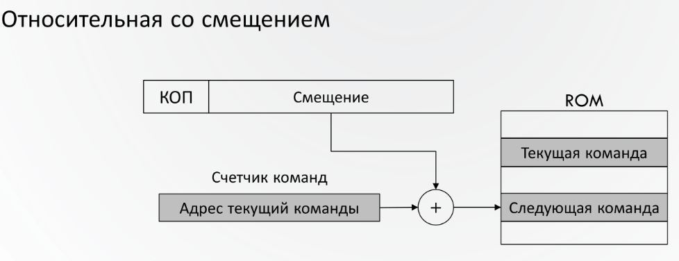

# Архитектура системы команд

- Шина данных (ШД) - 9 бит.
- Шина адреса (ША) - 7 бит.
- Шина управления (ШУ) - 5 бит.
- Инструкции в УУ необходимо передавать по ШД, следовательно, выбираются только размерности инструкций, кратные 9.
- Байт = 9 бит

### `mov` ROM->RAM (непосредственная)

- КОП+Операнд+Адрес = 3+8+7 = 18
- Занимает 2 байта

### `jz` (относительная, со смещением)
- =1, если последние данные в `data_register` =0

- 3 + 7 = 10
- Занимает 2 байта (оставшаяся часть младшего байта зарезервирована)

- RAM = 9 * 2^7 = 1152 (128 байт)
  ROM = 9 * 2^7 (64 команды)
- РОН = 3, 8 шт.

- ## Шина управления
- Значения битов:
- 0 - rom_r (чтение из ROM)
- 1 - ram_r (чтение из RAM)
- 2 - ram_w (запись в RAM)
- 3 - reg_r (чтение из регистра)
- 4 - reg_w (запись в регистр)

## Коды операций (КОП):
- 000 - `Mov`
- 111 - `Jz`

## Программа:
```micro
  Mov 500, $5           |    001111101 000000101           
  Jz $10                |    110001010                      
  Mov 0, $8             |    000000000 000001000           
  Jz $2                 |    110000010                      
  Mov 67, $67           |    000010000 111000011           
  Mov 256, $4           |    001000000 000000100           
```

## Разрядность специальных регистров
	Instruction Pointer - 7 
	Instruction Register - 18
	Address Register - 7
	Data Register - 9
	Flag Register - 1

## Адресация регистров общего назначения (РОН)