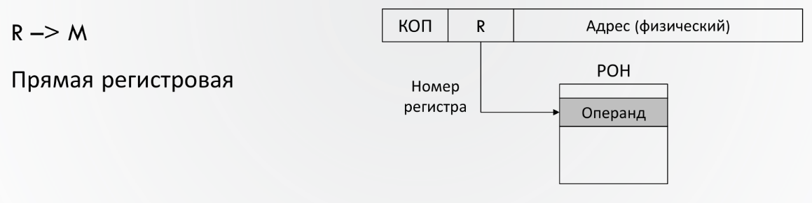
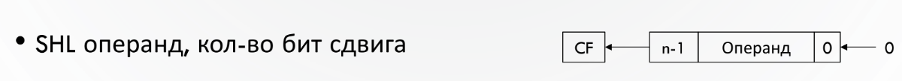

# Архитектура системы команд

- Шина данных (ШД) - 9 бит.
- Шина адреса (ША) - 7 бит.
- Шина управления (ШУ) - 9 бит.
- Инструкции передаются по ШД за 2 обращения и имеют размерность 18 бит (2 байта).
- Память данных (RAM) = 9 * 2^7 = 1152 бит (128 байт).
- Память команд (ROM) = 9 * 2^7 = 1152 бит (64 команды по 2 байта).
- РОН = 8 регистров (R0..R7) по 9 бит (адресация 3 младшими битами ША `adr[2..0]`).
- Байт = 9 бит.

### `movm` (ROM->RAM, непосредственная)


- КОП + Операнд (Const) + Адрес (RAM) = 3 + 8 + 7 = 18 бит (2 байта)

### `movr` (ROM->РОН, непосредственная)

- КОП + Операнд + Резерв + Регистр = 3 + 8 + 4 + 3 = 18 (2 байта)
- 4 старших бита адресного поля зарезервированы

### `shl` (прямая регистровая + непосредственная)




- Последний выдвинутый за пределы 9-битной сетки бит записывается во флаг переноса `CF`, обновляет `ZF`
- КОП + Операнд + Резерв + Регистр = 3 + 8 + 4 + 3 = 18 (2 байта)
- 4 старших бита адресного поля зарезервированы

### `sbb` (прямая регистровая + непосредственная)

- Вычитание с заёмом константы и флага переноса `CF` из значения в регистре (`Reg <- Reg - Операнд - CF`)
- Обновляет флаги заёма `CF` (=1 при беззнаковом переполнении вниз) и нуля `ZF`
- КОП + Операнд + Резерв + Регистр = 3 + 8 + 4 + 3 = 18 (2 байта)
- 4 старших бита адресного поля зарезервированы

### `xor` (прямая регистровая + непосредственная)

- Обновляет флаг нуля `ZF`
- КОП + Операнд + Резерв + Регистр = 3 + 8 + 4 + 3 = 18 (2 байта)
- 4 старших бита адресного поля зарезервированы

### `jz` (относительная, со смещением)

- `ZF`=1, если последние данные в `data_register` =0
  

- 3 + 7 = 10

- Занимает 2 байта (оставшаяся часть младшего байта зарезервирована)

- ### `push` (прямая регистровая)

- Записывает байт данных из регистра в стек

- КОП + Регистр + Резерв = 3 + 3 + 3 = 9 (1 байт)

- ### `pop` (прямая регистровая)

- Записывает байт данных из стека в регистр

- КОП + Регистр + Резерв = 3 + 3 + 3 = 9 (1 байт)

## Шина управления (ШУ):

- `0` - `rom_r` (чтение из ROM)
- `1` - `ram_r` (чтение из RAM)
- `2` - `ram_w` (запись в RAM)
- `3` - `reg_r` (чтение из РОН)
- `4` - `reg_w` (запись в РОН)
- `5` - `alu_op1_w` (запись 1-го операнда из РОН в буфер АЛУ)
- `6` - `alu_op2_w` (запись 2-го операнда из DR в буфер АЛУ)
- `7` - `alu_out_r` (выдача результата АЛУ на ШД)
- `8..9` - код операции АЛУ (`01` - SHL, `10` - SBB, `11` - XOR)
- `10` - `stack_r` (чтение из стека) 
- `11` - `stack_w` (запись в стек)

## Коды операций (КОП):

- `000` - `movm` (в память RAM)
- `001` - `movr` (в регистр РОН)
- `010` - `shl` (логический сдвиг влево)
- `011` - `sbb` (вычитание с заёмом)
- `100` - `xor` (исключающее ИЛИ)
- `101` - `push` (запись в стек)
- `110` - `pop` (чтение из стека)
- `111` - `jz` (переход, если 0)

## Программа:

```microcode
Команда       | Старший байт | Младший байт
movm 200, $5  | 000110010    | 000000101
jz $4         | 111000010    | 000000000
movr 180, R1  | 001101101    | 000000001
shl 2, R1     | 010000000    | 100000001
sbb 140, R1   | 011100011    | 000000001
xor 67, R1    | 100010000    | 110000001
#jz $100      | 111110010    | 000000000
jz $114       | 111111001    | 000000000  
```

## Разрядность специальных регистров:

- Instruction Pointer (IP) - 7 бит
- Instruction Register (IR) - 18 бит
- Address Register (AR) - 7 бит
- Data Register (DR) - 9 бит
- Flag Register (FR) - 2 бита (`ZF`, `CF`)
